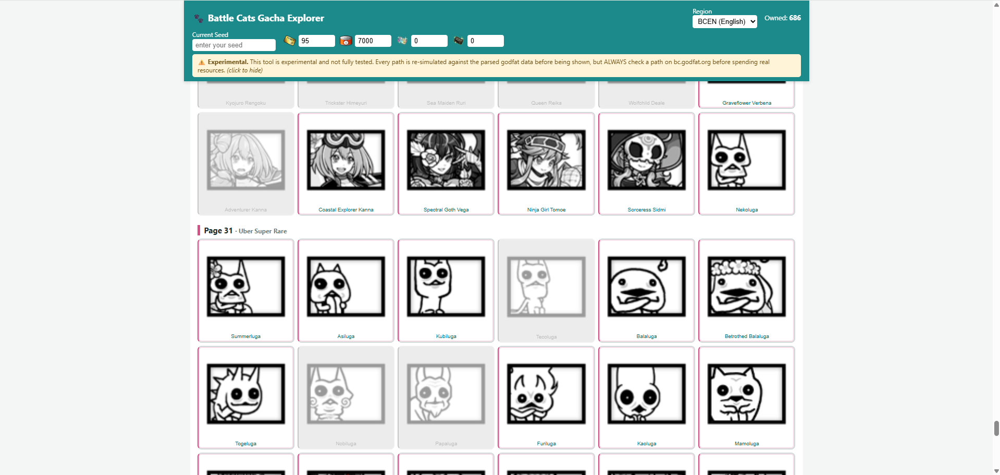
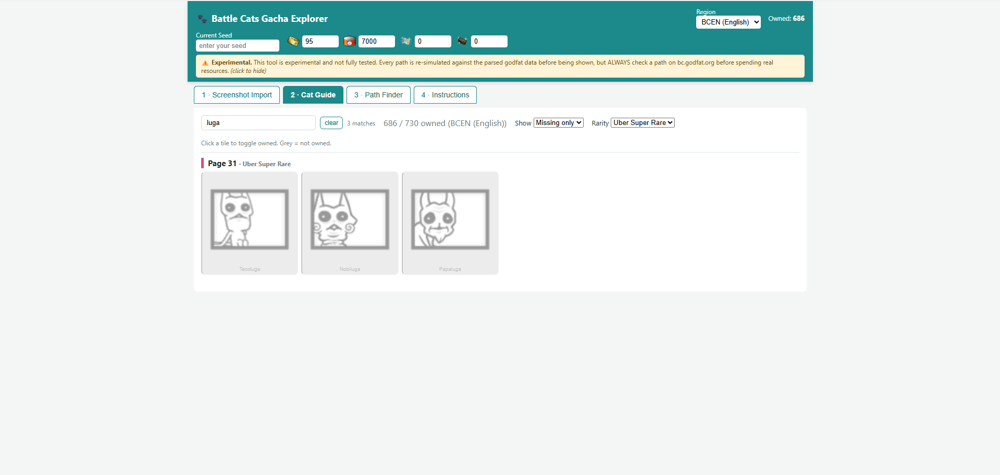
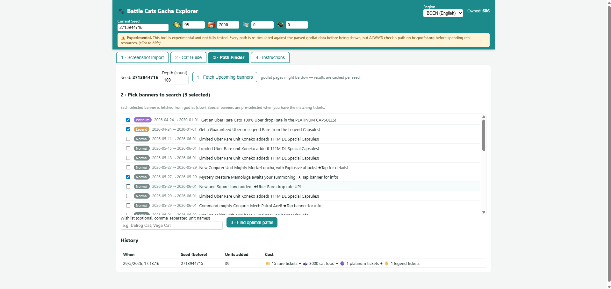
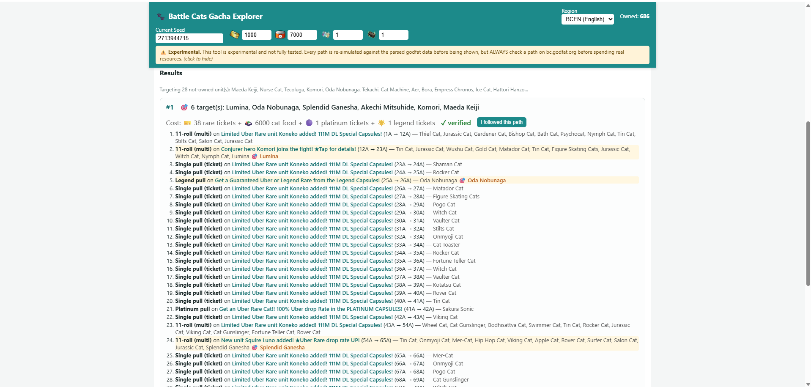

# Battle Cats Gacha Explorer

A web app that helps a Battle Cats player find the **most resource-efficient pull
path** to the units they don't yet own, using godfat seed-tracking data.

> ⚠️ **Experimental and not fully tested.** Every path the app shows is
> re-simulated against the roll tables before display, but **always
> check a path on [bc.godfat.org](https://bc.godfat.org/) before spending real
> resources.**

**Runs entirely in your browser** — no server, no accounts, no database. Your
collection lives in the page URL (a compact code) and in your browser, and the
roll tables and the path search are computed on your device. It has three tabs:

1. **Cat Guide** — a wiki-style grid mirroring the in-game Cat Guide order where
   you toggle units owned/not-owned. Includes a name search box, owned/rarity
   filters, and copy-link / copy-code / load-code buttons to save your collection.
2. **Path Finder** — enter your seed + resources; the app builds the roll tables
   of the *Upcoming* banners (godfat's roll logic and his open data, updated
   daily, so bc.godfat.org being slow or down doesn't matter), computes optimal
   paths to the units you don't own yet, or to the ones on your wishlist even if
   you own them (each path ends at its last target), shows them on a
   godfat-style **track table**, and offers an **"I followed this path"** button
   that marks every newly pulled unit as owned, decrements your resources, and
   **auto-fills your new seed**.
3. **Instructions** — an in-app usage guide.

## Screenshots

| Cat Guide | Cat Guide — search & filters |
| --- | --- |
|  |  |
| **Path Finder — pick banners** | **Path Finder — results** |
|  |  |

## Prerequisites — read this first

- **You must already be seed-tracking.** This app does **not** derive your seed;
  you provide it. You can find it via [bc-seek.godfat.org/seek](https://bc-seek.godfat.org/seek),
  and it's re-filled automatically each time you follow a path.
- **Nothing is stored on or sent to any server.** Your owned units, seed, and
  resources are saved in your browser and encoded in the page URL — bookmark it
  (or copy your code) to keep them for another device.
- **Region / version:** **BCEN (English) only**, unit list current as of game
  **version 15.6.1**. The Cat Guide list can be rebuilt for another region (see
  [Updating the data](#updating-the-data)) but other regions aren't bundled yet.

## Your data & privacy

There are no accounts and no server: the page loads static files and computes
everything on your device. Your **owned units, seed, and resources** are encoded
into the page URL (e.g. `…/#o=<code>&s=<seed>&r=…`) and saved in your browser
(localStorage), so:

- Opening the site again in the same browser brings everything back, even
  without the link.
- **Bookmark the page** (or use **Copy link** in the Cat Guide) to save everything
  for another device or browser; **Copy code** saves just your owned-units code,
  and **Load a code…** restores it.
- Opening a link whose data isn't what your browser saved asks which one to keep,
  so an old bookmark or someone else's link can't replace your saved collection.
- **Save in this browser** (Cat Guide) turns the browser's copy off and forgets
  it, e.g. on a shared computer. Private windows don't keep it, clearing site data
  deletes it, and Safari on iPhone drops it after about 7 days without a visit
  unless the site is on the home screen.

## How a typical session goes

1. **Cat Guide** tab — mark what you already own (click tiles; use the search box
   to find units). Copy your link/code to save it.
2. Top bar — enter your **seed** and your **resources** (rare tickets, cat food,
   platinum tickets, legend tickets).
3. **Path Finder** tab — *Fetch Upcoming banners*, tick the banners to search
   (special Platinum/Legend banners are pre-selected when you have the tickets),
   then *Find optimal paths*. The search runs in the background in your browser:
   usually well under a second; a big one (many banners, no wishlist) stops after
   20 s and shows the best paths found so far. The search button locks until you
   change a banner/wishlist. Under the paths, the **track table** shows each searched
   banner's roll table (tracks A and B, plus an 11-draw column on guaranteed
   banners) with the selected path shaded.
4. Pick a path, pull it in-game, then click **"I followed this path."** Every
   unit on that path is marked owned, your resources are decremented, and your
   **new seed is filled in automatically** — verify it on godfat, then search again.

### Pull cost model

- A single pull costs **1 rare ticket**; once your tickets run out, single pulls
  cost **150 cat food** (tickets are always spent first).
- An 11-roll (multi) costs **1500 cat food** — including on non-guaranteed
  banners, where it's just 11 consecutive normal pulls (cat food only).
- **Platinum / Legend Capsule** pulls cost **1 platinum / legend ticket** each
  (single guaranteed pulls; no 11-roll, no cat food/tickets). Excluded if you
  have 0 of that ticket.

## Running it locally

```bash
pnpm install
pnpm dev        # http://localhost:5173
pnpm build      # the static site, in dist/
```

It needs Node 22.13 or newer and pnpm (the version is pinned in `package.json`;
`corepack enable` sets it up).

## Tests

```bash
pnpm test
```

`node --test` runs everything in `tests/`:

- **Against godfat's own tables:** `rolls.test.mjs` rebuilds five roll tables
  saved from bc.godfat.org (`fixtures/sample_banners.txt`) cell for cell: 6,268
  values, including dupes, guaranteed ubers and the seed links.
- **Against the old Python engine:** the app used to run on a Python server, and
  `engine.test.mjs` checks the engine still gives exactly the results recorded
  from it before it was removed (`fixtures/golden.json`): 141 roll tables,
  Upcoming lists, ten complete searches (guaranteed banners, dupes, capsules,
  every mode, a 197-target search, the wishlist over owned units…) and "I followed
  this path" results. If you change the search on purpose, they show exactly
  what changed. It also covers the search's time and memory caps.
- **The rules:** `pathfinder.test.mjs` (costs, tickets first, 11-rolls, capsules,
  paths ending at their last target, dupes, track-table cells), `godfat-data.test.mjs` (cutting
  godfat's YAML down, series end dates, the Upcoming list, banners, seeds),
  `catalog.test.mjs` (the Cat Guide list's uid guards, name matching, targets and
  the wishlist, "I followed this path"), `owncode.test.mjs` (the URL code, and a
  mid-guide unit insertion can't shift or falsely-own existing units) and
  `browserSave.test.mjs`.

## Updating the data

- **Banner data** (godfat's events, gacha pools and cats): you don't need to do
  anything. A GitHub Actions job (`.github/workflows/update-data.yml`) runs
  `pnpm run update-data` every day: it downloads `build/bc-en.yaml` from
  [godfat's repo](https://gitlab.com/godfat/battle-cats-rolls), cuts it down to
  `public/data/godfat_bcen.json`, and commits it when it changed, which
  republishes the site. To get new banners sooner, start the job from the Actions
  tab or run `pnpm run update-data` yourself (`--input bc-en.yaml` reads a saved
  copy).
- **Cat Guide list** (when new units come out):
  `python scripts/update_cat_guide.py --url https://battlecats.miraheze.org/wiki/Cat_Guide
  --game-version 15.6.1 --previous public/data/cat_guide_master.json` rewrites
  `public/data/cat_guide_master.json` (if Miraheze blocks the bot, save the page
  in your browser and pass it with `--input Cat_Guide.html`; `--region` picks
  another version tab). Then `python scripts/download_icons.py` downloads the new
  icons into `public/icons/`. Both need only Python's standard library.

The Cat Guide tiles use those local icons (~723, in the repo) so the site doesn't
hit the wiki's CDN on every render; a missing one falls back to the wiki URL.

### Updating to a newer game version

When new units release, just re-run the Cat Guide scraper and download the new
icons. **Existing shared codes keep working:** the owned-code is keyed on each
unit's stable in-game `uid` (the `UniNNN` from its icon), not its Cat Guide
position, so newly added units only ever append higher uids and read as
not-owned in old codes — they never shift or falsely-own existing units. (The
`uid` rules are checked by `tests/catalog.test.mjs`, which fails if a re-scrape
ever breaks them.)

## Project layout

```
src/
  engine/           # rolls.js (roll tables: godfat's logic, Apache-2.0), data.js (banner data,
                    # Upcoming list), pathfinder.js (path search), names.js, services.js,
                    # search.worker.js (runs a search in the background)
  api.js            # the page's requests (banners, search, "I followed this path"), answered here
  owncode.js        # owned/seed/resources <-> URL code (the "save file")
  browserSave.js    # the same state saved in this browser (localStorage)
  components/       # Cat Guide, Path Finder, track table, instructions
public/
  data/             # godfat_bcen.json (banner data, updated daily), cat_guide_master.json
  icons/            # ~723 unit icons
  top_icons/        # top-bar resource icons
tests/              # node --test; fixtures/ has godfat's saved tables and the golden results
scripts/            # update-godfat-data.mjs (the daily data job), update_cat_guide.py, download_icons.py
.github/workflows/  # update-data.yml
LICENSES/           # third-party licences (battle-cats-rolls, Apache-2.0)
DECISIONS.md        # how it works and why: roll tables, godfat findings, banner mechanics, history
```

## Deploying

It's a static site: `pnpm build` and serve `dist/` anywhere (Vercel, Netlify,
GitHub Pages, nginx…). No server and no environment variables. The daily data
job's commits republish it on hosts that build on every push (Vercel does; its
project's Root Directory is the repository root).

See [DECISIONS.md](DECISIONS.md) for how the roll tables and the search work, what
was found out about godfat's site, banner-mechanic confirmations, and how the
app got here.

## License

Released into the **public domain** under [The Unlicense](LICENSE) — do whatever
you like with it, no attribution required.

Except `src/engine/rolls.js`: it's a port of the roll logic in godfat's
[battle-cats-rolls](https://gitlab.com/godfat/battle-cats-rolls) (Copyright Lin
Jen-Shin) and stays under the [Apache License 2.0](LICENSES/battle-cats-rolls-LICENSE.txt).
The banner data in `public/data/godfat_bcen.json` is extracted from the same
project (the game data in it is PONOS's).

The bundled unit names and icons come from the
[Battle Cats Wiki](https://battlecats.miraheze.org/) and remain subject to their
own terms; The Unlicense covers this project's code, not those third-party assets.
